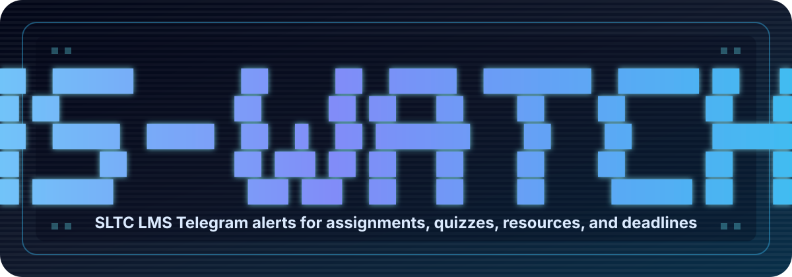

<p align="center">
  
</p>

# LMS-Watcher

LMS-Watcher is a Telegram notifier for the **SLTC Moodle LMS**. It checks your selected SLTC modules and alerts you when it finds new or changed assignments, quizzes, resources, forums, or calendar deadlines.

It is quiet when nothing changes. Text alerts are the main reliable notification. Screenshots are attached when possible, but screenshot problems never stop the text alert.

## Fast Setup

You need:

- SLTC LMS username and password
- Telegram account
- GitHub account
- Cloudflare account
- Node.js 22 and pnpm

Then run:

```bash
pnpm install
pnpm setup
```

The setup wizard explains each step and helps you connect Telegram, SLTC LMS, Cloudflare storage, GitHub Actions secrets, and watched modules.

Want to preview first without changing anything?

```bash
pnpm setup:dry-run
```

Need to check missing tools?

```bash
pnpm setup:doctor
```

## What You Get In Telegram

Example:

```text
[NEW] New assignment
Course: Software Quality Assurance
Title: Assignment 1
Open: https://lms.sltc.ac.lk/mod/assign/view.php?id=12345
Category: assignment
```

The watcher can also attach a logged-in screenshot when possible.

## What The Setup Wizard Does

`pnpm setup` guides you through:

1. Finding your GitHub repository.
2. Creating a Telegram bot with BotFather.
3. Connecting your Telegram chat.
4. Adding your SLTC LMS login.
5. Adding your Moodle calendar export URL.
6. Choosing SLTC modules by course ID or course name.
7. Connecting Cloudflare KV storage.
8. Uploading GitHub Actions secrets if GitHub CLI is available.
9. Showing the final verification commands.

Your local setup progress is saved in `.lms-watcher-setup.json`. Your private `.env` file is ignored by Git.

## Best Way To Choose Modules

Use the SLTC Moodle course ID from a course URL:

```text
https://lms.sltc.ac.lk/course/view.php?id=3549
```

For multiple modules:

```env
WATCHED_COURSE_IDS=3549,3555,3556
```

You can also use course names/codes:

```env
WATCHED_COURSE_NAMES=Software Quality Assurance,Cloud Security
```

Leave both empty only if you want to watch every visible SLTC LMS module.

## Verify After Setup

Run these commands after the wizard:

```bash
pnpm setup:check
pnpm verify:config
pnpm verify:kv
pnpm verify:telegram
pnpm verify:calendar
pnpm verify:moodle
pnpm watch
```

What they mean:

| Command | Checks |
| --- | --- |
| `pnpm setup:check` | Local setup and common mistakes |
| `pnpm verify:config` | Environment values and watched modules |
| `pnpm verify:kv` | Cloudflare KV storage |
| `pnpm verify:telegram` | Telegram bot and chat |
| `pnpm verify:calendar` | Moodle calendar export |
| `pnpm verify:moodle` | SLTC LMS login and item crawl |
| `pnpm watch` | One real watcher scan |

The first successful scan may create a baseline. After that, only new or changed LMS items are notified.

## How It Works

1. GitHub Actions runs the watcher on a schedule.
2. The watcher logs in to SLTC Moodle.
3. It checks selected module pages and the Moodle calendar feed.
4. It compares the new scan with the previous scan stored in Cloudflare KV.
5. New or changed items are sent to Telegram.
6. Failed Telegram text alerts stay pending and retry later.

A Cloudflare Worker scheduler can also trigger the same GitHub workflow as a backup schedule.

## Common Problems

### No notifications

Usually this means nothing new was added after your baseline scan.

Check:

```bash
pnpm verify:status
pnpm verify:moodle
```

### Wrong modules

Check your filters:

```bash
pnpm verify:config
```

To test all visible modules, temporarily leave both empty:

```env
WATCHED_COURSE_IDS=
WATCHED_COURSE_NAMES=
```

### Telegram does not send

Make sure:

- Bot token is correct.
- You pressed Start on the bot.
- Chat ID is correct.
- Bot is not blocked.

Run:

```bash
pnpm verify:telegram
```

### SLTC LMS login fails

Make sure:

- `LMS_BASE_URL` is `https://lms.sltc.ac.lk/login/index.php` or `https://lms.sltc.ac.lk`.
- Username/password are correct.
- You can log in from a normal browser.

Run:

```bash
pnpm verify:moodle
```

### Screenshots are missing

Screenshots are best-effort. Text alerts are still reliable.

```env
TELEGRAM_SCREENSHOTS=true
MAX_SCREENSHOTS_PER_RUN=10
```

## Safety Notes

- Never commit `.env`.
- Never share LMS passwords or tokens.
- Use your own Telegram bot and Cloudflare account.
- Rotate tokens immediately if exposed.
- Do not run random remote install scripts with your SLTC LMS credentials.

## Useful Commands

```bash
pnpm setup
pnpm setup:dry-run
pnpm setup:doctor
pnpm setup:check
pnpm verify:status
pnpm scheduler:check
pnpm scheduler:logs
```